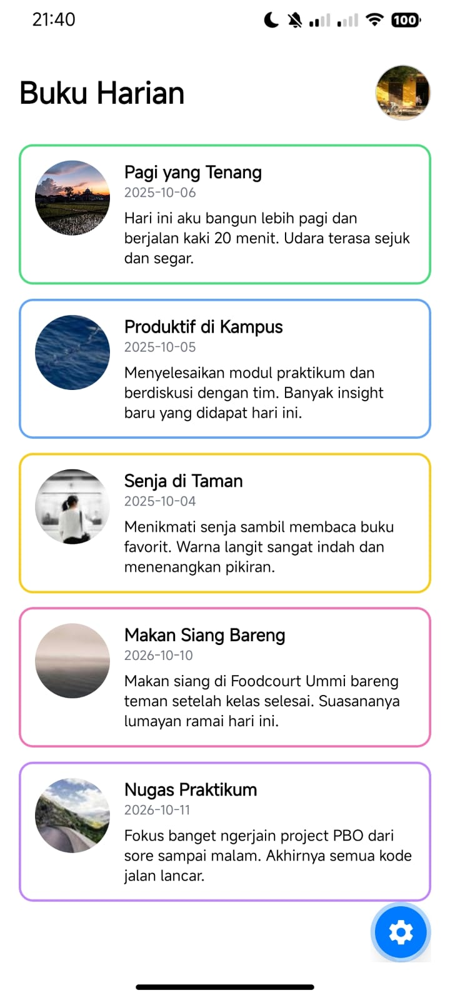

# Diary App - Pertemuan 2

## Identitas
- **Nama:** Nurrifani Herdiyanti
- **NIM:** 2430511016
- **Kelas:** 5A

## Fitur yang Diselesaikan
- Menampilkan daftar 5 entri buku harian (statis).
- Menggunakan komponen dasar React Native: `View`, `Text`, `Image`, `ScrollView`, dan `StyleSheet`.
- Memisahkan komponen kartu menjadi komponen *reusable* (`DiaryCard.js`).
- Menambahkan gambar lokal dari folder `assets/moods/`.
- Menambahkan variasi border warna pada kartu berdasarkan data mood.
- Menambahkan avatar pengguna di bagian header.

## Langkah Menjalankan Proyek
1. Buka terminal di dalam folder proyek.
2. Jalankan perintah `npm install` untuk menginstal dependensi.
3. Jalankan perintah `npx expo start` untuk menjalankan server.
4. Scan QR Code yang muncul menggunakan aplikasi Expo Go di smartphone.

## Screenshoot Tampilan
